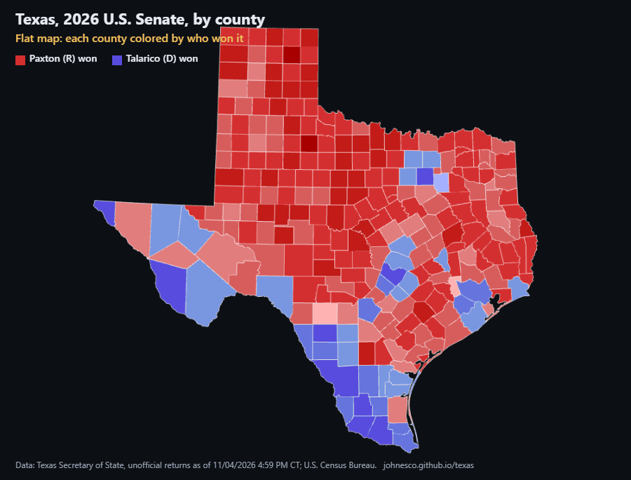

# Why Texas looks red

An interactive map of the 2026 statewide elections in Texas (Nov. 3, 2026): **U.S. Senate**, **Governor** and
**Lieutenant Governor**. It starts as the familiar flat county map, then raises each county into a column whose
height is the number of votes cast there. The point is to show why a map that is mostly red can still belong to a
statewide Democratic win. A race can be linked directly, e.g. `?race=governor` or `?race=lieutenant-governor`.

**Live:** https://johnesco.github.io/texas/



## Key figures (computed from the data file)

| | U.S. Senate | Governor | Lieutenant Governor |
|---|---|---|---|
| Democrat | James Talarico 5,444,982 (55.1%) | Gina Hinojosa 5,230,789 (52.8%) | Vikki Goodwin 5,083,581 (51.7%) |
| Republican | Ken Paxton 4,249,373 (43.0%) | Greg Abbott 4,524,527 (45.7%) | Dan Patrick 4,484,652 (45.6%) |
| Others + write-ins | 2.0% | 1.5% | 2.6% |
| Total votes | 9,889,704 | 9,907,381 | 9,828,050 |
| Counties won (R / D) | 214 / 40 | 217 / 37 | 218 / 36 |
| Land area of counties the Republican won | 78% | 79% | 80% |
| Votes cast in counties the Republican won | 29% | 31% | 32% |
| Harris County votes vs. smallest counties | 1,383,480 > 208 smallest combined | 1,383,460 > 207 smallest combined | 1,375,097 > 208 smallest combined |

## Data and method

- **Results:** Texas Secretary of State, Election Night Returns, 2026 November General Election (election id 53815),
  county-level results for every statewide race, as of 11/04/2026 04:59 PM Central, retrieved 2026-11-04. All precincts are
  reporting in all 254 counties. These results are **unofficial** until the state canvass.
  - Results site: https://goelect.txelections.civixapps.com/ivis-enr-ui/races
  - Data feed: https://goelect.txelections.civixapps.com/api-ivis-system/api/s3/enr/election/countyInfo/53815
  - Statewide page used as a cross-check: https://electionresults.sos.state.tx.us/results.html
- **Land area and FIPS codes:** U.S. Census Bureau, 2024 Gazetteer Files, counties (`ALAND_SQMI`, water excluded).
  https://www.census.gov/geographies/reference-files/time-series/geo/gazetteer-files.html
- **County shapes:** U.S. Census Bureau cartographic boundary files, 2017, via
  [us-atlas](https://github.com/topojson/us-atlas) v3.0.1 (`counties-10m.json`).
- **Column height** is proportional to the total votes cast in the selected race, counting every candidate including
  write-ins, on a linear scale (one scale shared by all races). Counties with very few votes get a thin minimum height so they stay visible.
- **Color** is the county winner's share of all votes cast there, in 10-point bands.

The raw snapshots are in [`data/raw/`](data/raw). [`scripts/build_data.py`](scripts/build_data.py) rebuilds
[`data/results-2026.json`](data/results-2026.json) from them. That file holds all 18 races that were on the ballot in
all 254 counties; the page currently offers U.S. Senate, Governor and Lieutenant Governor. The script stops with an
error unless all of these hold, for every race:

- the race is reported in each of the 254 counties, with all precincts reporting
- each county's candidate votes add up to its race total
- every county matches a Census FIPS code
- every candidate's county votes add up exactly to that candidate's total on the Secretary of State's statewide page

Candidate names are listed in capitals by the Secretary of State; the script converts them to normal capitalization
for display.

```bash
python scripts/build_data.py
```

## Running locally

The page loads its data with `fetch`, so it has to be served over HTTP:

```bash
python -m http.server 8765
```

Then open http://localhost:8765.

Built with [three.js](https://threejs.org) r160, [d3-geo](https://github.com/d3/d3-geo) 3.1.1 and
[topojson-client](https://github.com/topojson/topojson-client) 3.1.0.
